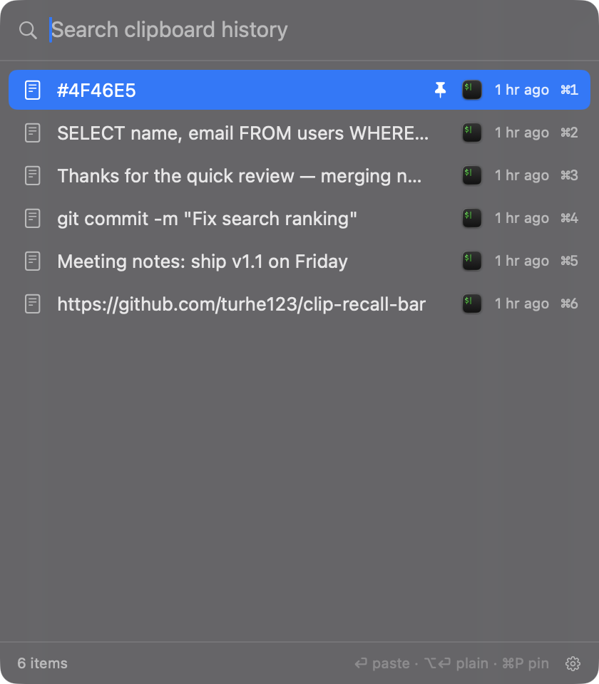
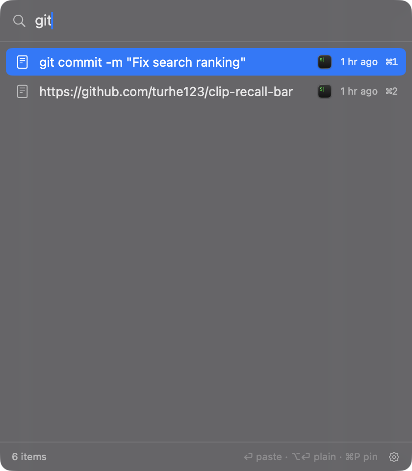
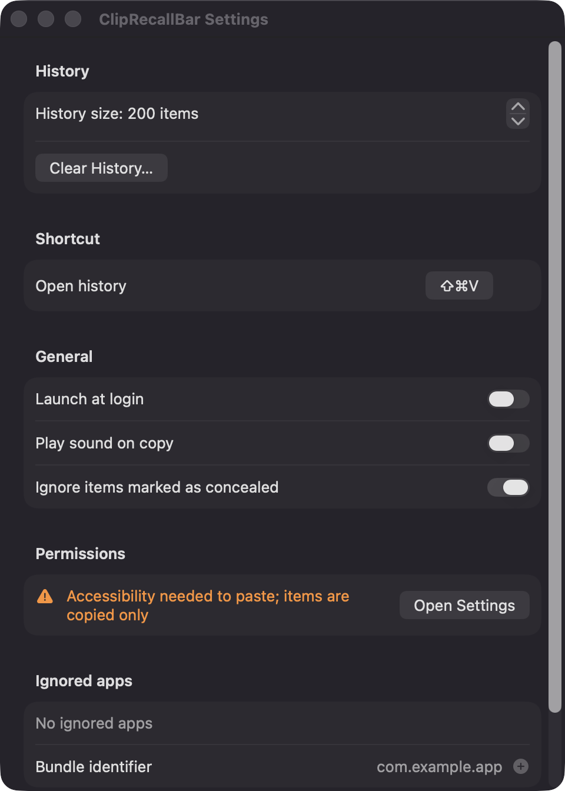
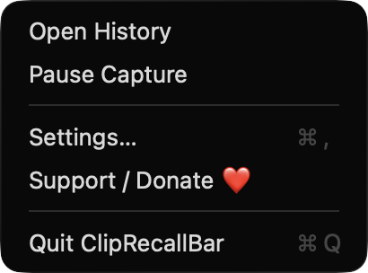

# ClipRecallBar

**🌐 Website:** [turhe123.github.io/clip-recall-bar](https://turhe123.github.io/clip-recall-bar/)

A keyboard-first clipboard history popup in your menu bar that filters as you type and pastes on Return.


## Why

ClipRecallBar is a free, open-source, 100% native, backend-free alternative to paid utilities in the *Clipboard* category. It was inspired by Maccy ($9.99 one-time), a great example of a fast, keyboard-driven clipboard manager. ClipRecallBar is an independent implementation with its own code and design. It has no accounts, no servers and no network code. Your history stays on your Mac.

## Features

- **Menu bar app** with no Dock icon. The status menu has Open History, Pause Capture, Settings…, Support / Donate ❤️ and Quit.
- **Global hotkey** (default `⇧⌘V`) opens a floating, borderless panel (420×480) near the mouse pointer, with the search field already focused. You can record a different shortcut in Settings. If another app already uses it, you see an inline error.
- **Filter as you type.** Case-insensitive, diacritic-insensitive substring matches rank first. Simple fuzzy (subsequence) matches follow.
- **Keyboard control**
  - `↑` / `↓` move the selection.
  - `Return` pastes into the app you were using.
  - `⌥Return` pastes as plain text.
  - `⌘1`–`⌘9` paste that row directly (`⌥⌘1`–`⌥⌘9` paste as plain text).
  - `⌘P` pins or unpins an entry.
  - `Delete` removes an entry.
  - `⌘,` opens Settings.
  - `Esc` closes the panel.
- **Captures** plain text, rich text (RTF is kept for rich paste), file URLs and images (stored as PNG).
- **Pinned entries** sort above the rest and survive Clear History.
- **Duplicates move to the top** instead of repeating.
- **Rows** show a type icon, a one-line preview, a pin badge, the source app's icon, a relative time and the `⌘1`–`⌘9` hint.
- **Privacy-minded capture**
  - Items marked concealed or transient (the community `org.nspasteboard` types, used by most password managers) are skipped. The concealed check can be turned off in Settings.
  - Add apps to an ignore list by bundle identifier.
  - Pause Capture from the menu.
- **Limits and robustness**
  - Text over 1 MB and images over 10 MB are skipped.
  - Copy bursts are debounced.
  - The app's own pastes are not re-captured.
  - A corrupt history file is moved aside with a dated name, and the app starts fresh.
  - Orphaned image files are pruned at launch.
  - Writes are atomic and happen off the main thread.
- **Settings:** history size (20–999, default 200), hotkey recorder, Launch at login, Play sound on copy, Ignore concealed items, ignored apps, Clear History (keeps pinned entries, after confirmation), and a live Accessibility status.
- **Graceful fallback.** Without Accessibility permission the item is still copied, and a banner says "Copied — press ⌘V to paste".

## Screenshots

<p align="center"></p>

<p align="center"><em>The floating history panel opened with ⇧⌘V: a focused search field, a pinned color code on top, source-app icons, relative times and ⌘1–⌘9 shortcuts.</em></p>

<p align="center"></p>

<p align="center"><em>Typing &quot;git&quot; instantly narrows the history to matching clips, ready to paste with Return.</em></p>

<p align="center"></p>

<p align="center"><em>Settings for history size, the global shortcut, launch at login, concealed-item privacy, Accessibility status and ignored apps.</em></p>

<p align="center"></p>

<p align="center"><em>The menu bar menu with Open History, Pause Capture, Settings, Support / Donate and Quit.</em></p>

## Install

1. Download `ClipRecallBar-macOS.zip` from the [latest release](https://github.com/turhe123/clip-recall-bar/releases/latest).
2. Unzip it and move `ClipRecallBar.app` to `/Applications`.
3. The app is open source and not notarized, so clear the quarantine flag:

   ```bash
   xattr -cr /Applications/ClipRecallBar.app
   ```

4. The first time, right-click the app and choose **Open**.

Requires macOS 14 (Sonoma) or later.

## Build from source

Requires Xcode (Swift 5.9+) and [XcodeGen](https://github.com/yonaskolb/XcodeGen).

```bash
brew install xcodegen
xcodegen generate
xcodebuild -project ClipRecallBar.xcodeproj -scheme ClipRecallBar -configuration Release -derivedDataPath ./build build
```

The app is produced at `build/Build/Products/Release/ClipRecallBar.app`.

## Permissions

| Permission | Why |
| --- | --- |
| **Accessibility** | Needed only to send the synthetic `⌘V` keystroke that pastes the selected item into the previous app. On first launch the app explains this and offers to open System Settings › Privacy & Security. If you decline, everything else still works. Items are copied and you press `⌘V` yourself. |
| **Login Items** (optional) | Only if you turn on *Launch at login*. macOS may ask you to approve it in System Settings › General › Login Items. |

ClipRecallBar does **not** request Screen Recording or Microphone access, and it makes no network connections. The global hotkey uses Carbon `RegisterEventHotKey`, which needs no permission. History is stored locally in `~/Library/Application Support/ClipRecallBar/`.

## Support ❤️

If ClipRecallBar is useful to you, you can support its development:

[☕ Support Or (Leo) Davidai ❤️](https://ko-fi.com/leodavidai)

## License

MIT © Or Davidai Bachar
